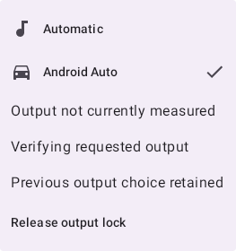
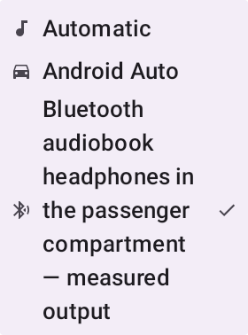

# Output chooser rendered review

Requirements PLAY-002 and PRODUCT_SPEC section 21. The current focused projector/router/continuity/Compose
checks pass 32 tests across four suites. The full strict repository gate and final combined-source CI
remain separate gates recorded in issue #289 and draft #300. The restored full strict presentation gate
also passes 2,784 tests /327 suites /960 playback with no failures, errors or skips, including lint,
Detekt and coverage. Unique/current-proof guard removal produced two expected projector failures;
misclassifying Car as Automatic produced its expected selected-row failure, including after structural
cleanup. Exact source bytes were restored before the passing full gate.

These synthetic SDK 34 Robolectric frames use the existing native canvas rendering approach. The
fixture contains no private device or media data. The first frame demonstrates explicit Car intent,
unmeasured output, active verification, retained previous choice and reachable release. The second
uses actual Android configuration `w375dp-h812dp`, font scale 2.0: the long measured endpoint wraps once
without clipping its full semantics or hiding selection. Visual review corrected faint disabled-style
status text and a duplicated measured name before retaining these frames.

The controls also exercise Automatic versus Car with no endpoints, current measurement versus policy
prediction, missing/multiple output, transfer phases, release, callback routing and a simulated landscape
configuration update. The latter changes Compose configuration; it does not recreate an Activity.
These frames do not prove TalkBack on a device, OEM layout behavior, physical sound, dashboard control
identity or zero interruption. Use the [combined device guide](output-ownership-device-acceptance.md)
for those acceptance results.
